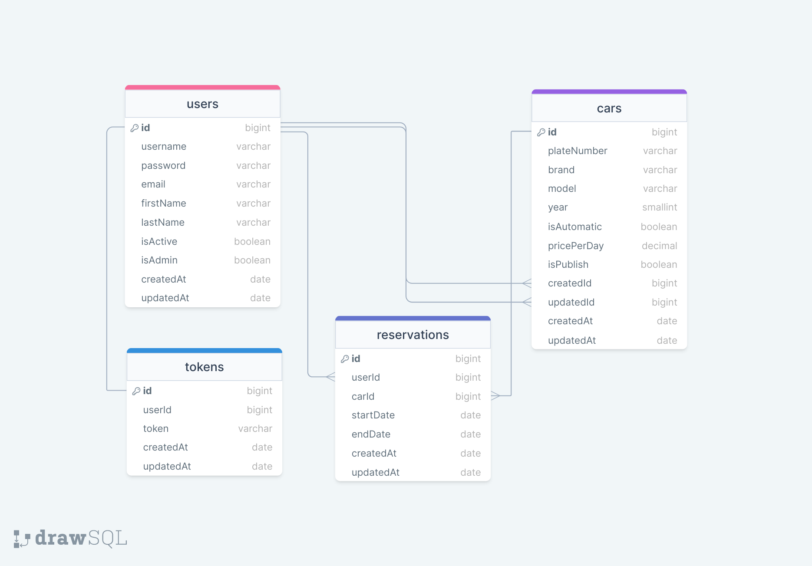

# RENT A CAR API

### Start:

```sh
cp .env-sample .env
npm i
npm run dev
```

### ERD:



--- 

### Rent A Car Project 

- Customers;
  - can select start and end date and see the list of available cars on selected dates.
  - can not reserve cars which are reserved by other customers on selected time period.
  - can choose a car on the list and reserve that car, but can not reserve more than one car on a selected time period,
  - can see the list of their reservations including past ones.
  - can list, create, read their reservations.
  - can not update, delete reservations.

- Admins;
  - can make CRUD operations on Car table,
  - can make CRUD operations on Customer (User) table,
  - can make CRUD operations on Reservation table,

- It can be createdId and updatedId in Car model.
- There will be searching, sorting and pagination capabilities on list views.

---

### Folder/File Structure:

```
    .env-sample
    .gitignore
    index.ts
    package.json
    readme.md
    swaggerAutogen.ts
    tsconfig.json
    src/
        configs/
            dbConnection.ts
            env.ts
            swagger.json
        controllers/
            auth.ts
            car.ts
            reservation.ts
            user.ts
        helpers/
            customError.ts
            dateToLocaleString.ts
            dateValidation.ts
            dummyData.ts
            passwordEncrypt.ts
            passwordValidation.ts
            sendMail.ts
            sync.ts
        middlewares/
            authentication.ts
            errorHandler.ts
            logger.ts
            permissions.ts
            queryHandler.ts
            upload.ts
        models/
            car.ts
            reservation.ts
            user.ts
        routes/
            auth.ts
            car.ts
            document.ts
            index.ts
            reservation.ts
            user.ts
        types/
            api.ts
            express.d.ts
```